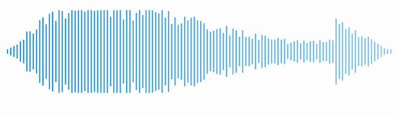
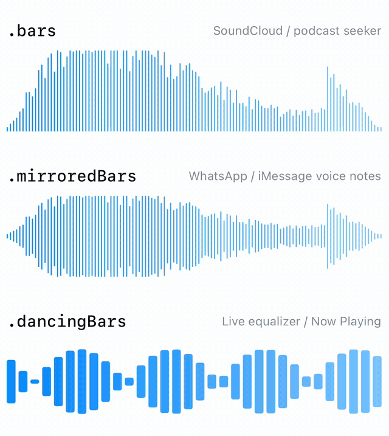

# WaveformKit

A SwiftUI waveform visualization framework for audio apps. Handles decoding, caching, FFT analysis, async loading lifecycle, and rendering in one package — with a realtime-safe audio pipeline and zero external dependencies.

<p align="center">
  
</p>


---

## Why WaveformKit

Existing options force a choice: a static-image generator with no interaction (*DSWaveformImage*), a full audio engine dependency (*AudioKit*), or a UIKit view from 2015 (*FDWaveformView*). WaveformKit is a single SwiftUI-native package that covers the complete path from audio file to interactive waveform without any of those tradeoffs.

Key design decisions that differentiate it:

- **Swift 6 ready** — builds clean under the Swift 6 language mode with complete concurrency checking; CI fails the build on any new warning.
- **Zero-allocation audio callbacks** — FFT processing uses pre-allocated scratch buffers and vectorised vDSP operations. No heap allocations on the audio render thread.
- **Async loading lifecycle** — `WaveformLoader` drives `WaveformState` (`.idle → .loading(progress) → .loaded / .failed`) so loading, progress, and error states are first-class, not afterthoughts.
- **Extensible renderer protocol** — `WaveformRenderer` lets you supply a custom drawing implementation without forking. Built-in styles are backed by the same protocol surface.
- **Zoom and pan, wired** — pinch to zoom anchored under the pinch centroid, drag to pan, double-tap to reset. `WaveformViewport` is a plain `Sendable` value you can also drive programmatically, and the gesture arithmetic is pure and unit-tested.
- **Complete, not minimal** — decoding, disk caching, FFT spectrum, live mic, seek gestures, markers, accessibility, and snapshot export are all included.

---

## Features

- Six built-in waveform styles: bars, mirrored bars, dancing bars, line, dots, circular
- Four movement modes: progress-fill, reactive (FFT-driven), combined, idle shimmer
- `WaveformLoader` with `WaveformState` async lifecycle — progress, error, and retry built in
- `WaveformRenderer` protocol for fully custom styles without forking
- Pinch-to-zoom, drag-to-pan, and double-tap-to-reset via `WaveformViewport` — `ScrollView`-safe
- Region selection with draggable edges, snapping, and VoiceOver editing, bound to a plain `ClosedRange`
- Right-to-left support: in Arabic and Hebrew layouts time runs right to left, as Apple's HIG asks of progress controls
- Multi-resolution summaries (`WaveformSummaryPyramid`), so zooming in reveals real detail
- Opt-in Metal backend for timelines with thousands of bars
- Seek gestures on all styles — linear drag on bar/line/dot styles, angular drag on circular
- Markers and region overlays with tap callbacks, VoiceOver children, and circular-style support
- Live microphone capture (`MicrophoneRecorder`) with bounded memory and interruption handling
- Three player paths: `AVPlayer` (streaming/local), `AVAudioPlayer` (local), `AVAudioEnginePlayer` (local + FFT)
- Real FFT spectrum via `MTAudioProcessingTap` on the audio render thread (Hann-windowed, 1024-point, log-spaced bands)
- Resample cache — amplitude arrays are computed once per summary; 30–60 Hz re-renders hit a dictionary lookup
- Disk waveform cache keyed by file identity, with an LRU byte budget
- VoiceOver: adjustable element with `X:XX of Y:YY` value; per-marker accessibility children
- `WaveformView.snapshot(...)` → `CGImage` for thumbnails and share sheets
- Peak- or mean-pooled resampling (`WaveformResampleMode`) — transients survive a low bar count
- Zero external dependencies — AVFoundation, MediaToolbox, Accelerate only
- DocC documentation hosted on Swift Package Index

---

## Requirements

- iOS 17.0+ / macOS 14.0+ / visionOS 1.0+
- Swift 6.0+ / Xcode 16+

The package builds under the **Swift 6 language mode** with complete concurrency checking and no
warnings. It declares `swiftLanguageModes: [.v6, .v5]`, so it still compiles if your project pins
a Swift 5 language mode — but the toolchain itself must be 6.0 or newer.

---

## Installation

**Xcode:** File → Add Package Dependencies → enter the repository URL.

**Package.swift:**
```swift
dependencies: [
    .package(url: "https://github.com/GRimAce11/WaveformKit.git", from: "0.6.0")
]
```

---

## Demo App

A runnable showcase app lives in [`Demo/`](Demo/). Open `Demo/Test Waveform.xcodeproj` — it references WaveformKit via local path so it builds immediately without an SPM fetch.

| Screen | What it shows |
|---|---|
| **Style Gallery** | All 6 styles with live movement, colour, and progress controls |
| **Playback** | `WaveformLoader` + `AVPlayer` + markers + seek scrubbing |
| **Async Loading** | `WaveformState` lifecycle — progress bar, cancel, retry, error |
| **Microphone** | Live FFT recording + interruption handling + captured-file playback |
| **Custom Renderer** | Three `WaveformRenderer` implementations with annotated source |
| **Viewport** | Pinch / pan / double-tap gestures, both `dragBehavior` modes, inside a `ScrollView` |
| **Selection** | Create and adjust a region, both activation modes, snapping, zoom to selection, right-to-left layout |

The demo generates a test tone on-device at first launch — no bundled audio files, no network required.

---

## Quick Start

The recommended entry point is `WaveformLoader` + `WaveformView(loader:)`. It handles the loading lifecycle, shows a skeleton shimmer while decoding, and transitions cleanly to the real waveform.

```swift
import SwiftUI
import WaveformKit

struct PlayerView: View {
    let url: URL

    @State private var loader  = WaveformLoader()
    @State private var adapter = AVPlayerAdapter(player: AVPlayer())
    @State private var tap: AVPlayerAmplitudeTap?

    var body: some View {
        WaveformView(
            loader:   loader,
            currentTime: adapter.currentTime,
            amplitude:   tap?.currentAmplitude ?? 0,
            bands:       tap?.bands ?? [],
            style:    .dancingBars(count: 32),
            movement: .reactive(boost: 1.4),
            colors:   WaveformColors(played: .accentColor, unplayed: .secondary.opacity(0.25)),
            onSeek:   { adapter.seek(to: $0) }
        )
        .waveformStateOverlay(loader.state)
        .frame(height: 80)
        .task {
            let player = AVPlayer(url: url)
            adapter = AVPlayerAdapter(player: player)
            tap     = AVPlayerAmplitudeTap(player: player, bandCount: 32)
            loader.load(url: url)
            player.play()
        }
    }
}
```

`WaveformView(loader:)` renders an `.idle` shimmer while the summary decodes, then transitions to the real waveform once `loader.state == .loaded`. `.waveformStateOverlay` adds a progress bar during loading and an error view if decoding fails.

---

## Async Loading Lifecycle

`WaveformLoader` is an `@Observable @MainActor` class that manages the full decode cycle. It exposes a single `state: WaveformState` property that drives your UI reactively.

```swift
public enum WaveformState {
    case idle
    case loading(progress: Double)   // 0.0 ... 1.0
    case loaded(WaveformSummary)
    case failed(Error)
}
```

### Observe state directly

```swift
@State private var loader = WaveformLoader()

var body: some View {
    switch loader.state {
    case .idle:
        Text("No file selected")
    case .loading(let p):
        ProgressView(value: p).padding()
    case .loaded(let summary):
        WaveformView(summary: summary, currentTime: 0)
    case .failed(let error):
        Label(error.localizedDescription, systemImage: "xmark.circle")
    }
}
```

### Loading, cancellation, retry

```swift
// Start a decode (cancels any in-progress decode first)
loader.load(url: fileURL, targetBars: 200, useCache: true)

// Cancel a running decode — state → .idle
loader.cancel()

// Retry after a failure
loader.retry()
```

### Loading from an `AudioSource`

When a feed mixes files that still need decoding with summaries you already hold — fetched from
a server, restored from a previous session — both go through the same call. A `.precomputed`
source resolves to `.loaded` synchronously: no decode, no cache write, no progress ticks.

```swift
let source: AudioSource = item.cachedSummary.map(AudioSource.precomputed)
                       ?? .file(item.localURL)
loader.load(source: source)
```

### Inject a pre-computed summary

```swift
// The same thing load(source:) does for .precomputed, when you have no AudioSource to wrap
loader.set(WaveformSummary.demo(duration: 30))
```

### Backward-compatible static API

The original one-shot static method is preserved for source compatibility:

```swift
let summary = try await WaveformLoader.load(url: url, targetBars: 200)
```

---

## Wave Styles

<p align="center">
  
</p>

<p align="center"><em>Recorded from the bundled demo app — <code>.bars</code>, <code>.mirroredBars</code> and <code>.dancingBars</code> under <code>.reactive</code> movement.</em></p>

| Style | Appearance | Typical Use |
|---|---|---|
| `.bars` | Vertical bars rising from the bottom | Podcast seeker, SoundCloud |
| `.mirroredBars` | Bars centered on the midline | WhatsApp / iMessage voice notes |
| `.dancingBars` | Bouncing equalizer bars | "Now Playing" widgets, live audio |
| `.line` | Smooth filled mirrored curve | Minimal / editorial |
| `.dots` | Capsules along the midline | Voice note minimal |
| `.circular` | Radial bars around a centre | Album art overlay, AirPods UI |

```swift
WaveformView(summary: s, currentTime: t, style: .bars(count: 120))
WaveformView(summary: s, currentTime: t, style: .mirroredBars())
WaveformView(summary: s, currentTime: t, style: .line(thickness: 1.5))
WaveformView(summary: s, currentTime: t, style: .dots(count: 60))
WaveformView(summary: s, currentTime: t, style: .circular(count: 64))
    .aspectRatio(1, contentMode: .fit)

// Live spectrum analyzer
WaveformView(summary: s, currentTime: t,
             amplitude: tap.currentAmplitude, bands: tap.bands,
             style: .dancingBars(count: 32), movement: .reactive())
```

---

## Movement Modes

| Mode | Behaviour |
|---|---|
| `.progress` | Static waveform; played/unplayed colour split |
| `.reactive(boost:)` | Bar height scales with live amplitude; no progress fill |
| `.combined(boost:)` | Progress fill AND reactive amplitude on the played portion |
| `.idle` | Ping-pong shimmer — loading skeleton or paused state |

---

## Resample Modes

A summary is decoded at a fixed resolution (200 bins by default) and a view can ask for any
number of bars. When there are more bins than bars, each bar has to stand for several bins —
`resampleMode` decides how they collapse.

| Mode | Each bar becomes | Looks like |
|---|---|---|
| `.peak` *(default)* | the loudest bin it covers | Transients survive: drum hits, plosives, edits |
| `.mean` | the average of its bins | Smooth, flat, low-contrast |

```swift
WaveformView(summary: s, currentTime: t, style: .bars(count: 60), resampleMode: .peak)
```

Because the decoder has already reduced each bin to an RMS value, `.mean` is an average of
averages — peaks erode quickly as the bar count drops, and a busy track flattens toward a
uniform block. `.peak` keeps the shape recognisable as *that* recording. Use `.mean` when you
deliberately want an even, ambient level-meter look.

> **Changed in 0.6.0:** `.peak` is the new default. Pre-0.6.0 behaviour was mean pooling —
> pass `resampleMode: .mean` to keep the old appearance.

---

## Metal Rendering

`Canvas` fills one path per bar on the CPU, which is ideal for a 100-bar seek bar and starts to
cost real frame time in the thousands — the range a zoomable editor timeline reaches once the
pyramid gives it the detail. The Metal backend draws every bar in one instanced GPU draw call.
It is opt-in, set once for a whole subtree:

```swift
WaveformView(summary: summary, currentTime: t, style: .bars(count: 2_000, spacing: 0))
    .waveformRenderingBackend(.automatic())   // Metal at 512+ bars, Canvas below
```

| Backend | Draws `.bars` / `.mirroredBars` with |
|---|---|
| `.canvas` *(default)* | `Canvas`, as in every earlier release |
| `.metal` | Metal at any bar count |
| `.automatic(minimumBarCount: 512)` | Metal at or above the threshold, `Canvas` below |

- Covers `.bars` and `.mirroredBars`, including solid colours, horizontal gradients, the
  played/unplayed split, corner radius and reactive scaling. Other styles always use `Canvas`.
- Falls back to `Canvas` by itself — no Metal device, or the first few milliseconds while the
  shader compiles — so a view is never blank.
- Needs nothing from your build: the shader is compiled at runtime by the OS, so the package
  does not depend on Xcode's separately downloaded Metal Toolchain.
- `WaveformView.snapshot` always renders with `Canvas`, since `ImageRenderer` cannot capture a
  Metal-backed view.
- Bars are at least 1 pt wide. At very large counts pass `spacing: 0`, or the row overflows the
  trailing edge.

---

## Custom Renderers

Implement `WaveformRenderer` to draw anything without modifying the library.

```swift
struct OscilloscopeRenderer: WaveformRenderer {
    func draw(
        context: inout GraphicsContext,
        size: CGSize,
        amplitudes: [Float],
        progress: Double,
        amplitudeScale: CGFloat,
        showsProgress: Bool,
        colors: WaveformColors
    ) {
        guard amplitudes.count > 1 else { return }
        let midY = size.height / 2
        var path = Path()
        path.move(to: CGPoint(x: 0, y: midY))
        for (i, amp) in amplitudes.enumerated() {
            let x = size.width * CGFloat(i) / CGFloat(amplitudes.count - 1)
            let y = midY - CGFloat(amp) * amplitudeScale * midY
            path.addLine(to: CGPoint(x: x, y: y))
        }
        context.stroke(path, with: .color(colors.played), lineWidth: 1.5)
    }
}

WaveformView(
    summary: summary,
    currentTime: player.currentTime,
    style: .custom(renderer: OscilloscopeRenderer(), barCount: 200)
)
```

`WaveformRenderer` conformances must be `Sendable`. Stateless value types are the simplest approach; class-based renderers with mutable state need their own synchronisation (`@unchecked Sendable` + a lock or actor).

---

## Zoom & Pan

Pass a `WaveformViewport` binding and the view becomes zoomable: pinch to zoom, drag to pan,
double-tap to reset. Without a binding nothing changes — the gestures have no state to drive.

```swift
@State private var viewport = WaveformViewport(duration: summary.duration)

WaveformView(
    summary:     summary,
    currentTime: player.currentTime,
    viewport:    $viewport,
    onSeek:      { player.seek(to: $0) }
)
```

A pinch is anchored at the gesture centroid, so the audio under your fingers stays put. Zoom is
clamped to `maxZoomFactor` and `minVisibleDuration`, whichever binds first.

### Choosing what a drag means

Pinch always zooms. The ambiguous input is the one-finger drag — it could mean "scrub" or
"scroll the timeline" — so `WaveformZoomOptions.dragBehavior` picks:

| Behaviour | Drag at 1× | Drag while zoomed | Use for |
|---|---|---|---|
| `.seek` *(default)* | seeks | seeks | Players — scrubbing is the point |
| `.panWhenZoomed` | seeks | pans the visible range | Editors — the waveform is a timeline |

```swift
WaveformView(summary: summary, currentTime: t, viewport: $viewport, zoom: .editor)
```

Three presets cover the common cases:

```swift
.disabled      // no gestures; drive the viewport programmatically only
.editor        // dragBehavior = .panWhenZoomed
.inScrollView  // vertical drags scroll the enclosing list instead of seeking
```

Or build your own:

```swift
WaveformZoomOptions(
    dragBehavior:           .panWhenZoomed,
    maxZoomFactor:          20,
    minVisibleDuration:     0.5,
    resetsOnDoubleTap:      true,
    yieldsToVerticalScroll: false
)
```

### Inside a ScrollView

A waveform row in a scrolling list has a real conflict: a `minimumDistance: 0` drag claims the
touch immediately and the list stops scrolling. `.inScrollView` resolves it by attaching the
gesture *simultaneously* rather than exclusively, and by withholding any seek or pan until the
touch has travelled `scrollIntentThreshold` points — at which point a drag taller than it is wide
is abandoned for the rest of the gesture. Taps still seek.

```swift
List(episodes) { episode in
    WaveformView(
        summary:     episode.summary,
        currentTime: episode.position,
        viewport:    $viewport,
        zoom:        .inScrollView,
        onSeek:      { seek(episode, to: $0) }
    )
    .frame(height: 44)
}
```

### Double-tap

Double-tapping resets to the full-duration view. The first tap of the pair still seeks — on a
waveform a tap means "play from here", and suppressing it would mean delaying *every* tap by the
double-tap interval. Set `resetsOnDoubleTap: false` to turn it off.

### Driving it programmatically

The viewport is an ordinary value type, so gestures and code can both move it:

```swift
// Jump to a specific region
viewport.visibleRange = 95...125   // seconds

// Zoom 4× centred on the playhead
viewport.zoom(to: 4, anchor: player.currentTime / summary.duration)

// Pan forward 10 seconds
viewport.pan(by: 10)

// Reset
viewport.resetZoom()
```

When `viewport` is `nil` (the default) or `zoomFactor == 1.0`, `WaveformView` behaves exactly as
it did before 0.6.0 — no breaking change.

### Detail at high zoom

A summary's `amplitudes` hold about 200 bins, which is all a full-width seek bar needs — but zoom
in 20× and only ten are left to spread across the bars. So `AudioDecoder` also builds a
`WaveformSummaryPyramid`: a 16 384-bin base level plus coarser levels, each half the size of the
last, computed in the same pass over the file. At every zoom factor the view draws from the
coarsest level that still has a bin per bar, so zooming keeps revealing real transients instead
of stretching blocks, and the per-frame cost tracks the bar count rather than the file length.

There is nothing to switch on — summaries from `WaveformLoader` and `AudioDecoder` carry a
pyramid by default. To tune it:

```swift
loader.load(url: fileURL, pyramidResolution: 65_536)   // more detail for long files
loader.load(url: fileURL, pyramidResolution: 0)        // flat amplitudes only; never zooms
```

Bins are never shorter than 64 frames (~1.5 ms at 44.1 kHz), so very short files get fewer.
The pyramid costs about 44 KB in the disk cache and 190 KB in memory at the default. Summaries
you build yourself can carry one too: `WaveformSummary(..., pyramid: WaveformSummaryPyramid(amplitudes: fineBins))`.

---

## Region Selection

Pass a `selection` binding and the waveform becomes a range picker — for trimming a voice
note, looping a section, or exporting a clip. The range is a plain
`ClosedRange<TimeInterval>?` that you own:

```swift
@State private var selection: ClosedRange<TimeInterval>?

WaveformView(
    summary:          summary,
    currentTime:      player.currentTime,
    viewport:         $viewport,          // optional — selection works zoomed or not
    selection:        $selection,
    selectionOptions: .editor,
    onSeek:           { player.seek(to: $0) }
)

Button("Trim") { trim(to: selection!) }
    .disabled(selection == nil)
```

| Gesture | Result |
|---|---|
| Hold, then drag *(default `.longPress()`)* | Creates a selection; a plain drag still seeks |
| Drag *(`.editor`, i.e. `activation: .drag`)* | Creates a selection; taps still seek |
| Drag an edge | Adjusts that edge — 44 pt touch target; dragging past the other edge swaps them |
| Tap outside | Clears the selection (`clearsOnTapOutside`) and seeks |

```swift
WaveformSelectionOptions(
    activation:           .longPress(holdDuration: 0.4),
    minimumLength:        0.1,     // shorter drags are discarded on release
    snapInterval:         0.5,     // snap both edges to a 0.5 s grid; nil = free
    clearsOnTapOutside:   true,
    updatesWhileDragging: false,   // write the binding once, on release
    tint:                 .orange  // nil = the played colour
)
```

`updatesWhileDragging: false` is for selections that trigger expensive work — restarting a
looped playback, regenerating a preview — so it runs once per gesture rather than once per
frame. The range under the finger is drawn live either way.

**VoiceOver.** With no selection, the waveform offers a *Select from playhead* action. Once one
exists, *Selection start* and *Selection end* become adjustable elements (swipe up/down moves
them by the snap interval, or 1 % of the file), the waveform's label reads the range, and a
*Clear selection* action appears.

Selection is drawn and hit-tested through the viewport, so it stays under your finger while
zoomed. `.circular` ignores it.

---

## Right-to-Left Languages

Apple's Human Interface Guidelines ask apps to *"flip controls that show progress from one value
to another"* in right-to-left languages, the way sliders and progress bars do. A waveform seek bar
is one, so in an Arabic or Hebrew layout `WaveformView` runs time from the right edge to the left
by default — no code needed.

Everything that maps time to position flips together: the bars and their played colouring,
seeking, drag-to-pan (the audio still follows your finger), the pinch anchor, markers, the
selection, and the positions of VoiceOver elements. Marker labels move to the other side of their
marker but are never mirrored, and VoiceOver still visits markers and selection edges in time
order. Digits are never reversed.

To pin the direction — a DAW-style editor that keeps time left to right in every language, say:

```swift
WaveformView(summary: summary, currentTime: t)
    .waveformTimelineDirection(.leftToRight)   // .automatic (default) / .leftToRight / .rightToLeft
```

`.circular` always runs clockwise from the top: the guidelines treat clock faces as the same in
every language. `WaveformView.snapshot` has no app environment to read, so pass
`layoutDirection: .rightToLeft` when rendering one for an RTL UI.

---

## Players

### AVAudioEnginePlayer — local files + FFT

For local files with live spectrum bands, `AVAudioEnginePlayer` conforms to both `WaveformPlayerAdapter` and `AmplitudeTap`:

```swift
let player = try AVAudioEnginePlayer(url: url, bandCount: 32)
player.play()

WaveformView(
    summary:    summary,
    currentTime: player.currentTime,
    amplitude:  player.currentAmplitude,
    bands:      player.bands,
    style:      .dancingBars(count: 32),
    movement:   .reactive(),
    onSeek:     { player.seek(to: $0) }
)
```

### AVPlayer — streaming and local

```swift
let player  = AVPlayer(url: url)
let adapter = AVPlayerAdapter(player: player)
let tap     = AVPlayerAmplitudeTap(player: player, bandCount: 32)

WaveformView(
    summary:    summary,
    currentTime: adapter.currentTime,
    amplitude:  tap.currentAmplitude,
    bands:      tap.bands,
    onSeek:     { adapter.seek(to: $0) }
)
```

`MTAudioProcessingTap` runs on the audio render thread. The main thread polls at 30 Hz with attack/decay envelope smoothing.

### AVAudioPlayer — local files, simple

```swift
let player  = try AVAudioPlayer(contentsOf: url)
let adapter = AVAudioPlayerAdapter(player: player)
let tap     = AVAudioPlayerAmplitudeTap(player: player)
// tap.bands is always empty — AVAudioPlayer has no PCM access
```

---

## Markers & Regions

```swift
let markers: [WaveformMarker] = [
    WaveformMarker(time: 12,               color: .yellow, label: "Intro"),
    WaveformMarker(time: 48, duration: 22, color: .orange, label: "Verse 1"),
    WaveformMarker(time: 95,               color: .pink,   label: "Drop"),
]

WaveformView(
    summary:     summary,
    currentTime: t,
    style:       .mirroredBars(count: 120),
    markers:     markers,
    onSeek:      { player.seek(to: $0) },
    onMarkerTap: { marker in player.seek(to: marker.time) }
)
```

- **Point markers** (`duration: 0`): vertical line + dot. Tap → `onMarkerTap`.
- **Region markers** (`duration > 0`): translucent band + edge stripe. Tap inside or near an edge → `onMarkerTap`.
- A drag always fires `onSeek`; `onMarkerTap` only fires on a tap (no drag).
- All six styles support markers. `.circular` renders radial ticks and arc regions with arc-length hit-testing.

---

## Live Microphone Recording

```swift
@State private var recorder = MicrophoneRecorder(
    bandCount:       32,
    binsPerSecond:   20,
    maximumDuration: 60,
    outputURL: FileManager.default.temporaryDirectory
                   .appendingPathComponent("memo.caf")
)

var body: some View {
    WaveformView(
        summary:    recorder.summary,
        currentTime: recorder.currentTime,
        amplitude:  recorder.currentAmplitude,
        bands:      recorder.bands,
        style:      .mirroredBars(count: 80),
        movement:   .reactive(boost: 1.4)
    )
    .frame(height: 60)
    .task { try? await recorder.start() }
}
```

Requires `NSMicrophoneUsageDescription` in Info.plist. Interruptions and route changes are handled automatically. Set `autoResumeAfterInterruption: false` to stay paused after a phone call.

Memory is bounded: when the amplitude array exceeds `maxBins` (default 4000), adjacent pairs are averaged in-place. A 24-hour recording stays under 16 KB.

---

## FFT Spectrum

`AVPlayerAmplitudeTap` and `AVAudioEnginePlayer` run a 1024-point Hann-windowed FFT on the audio render thread. Bands are logarithmically spaced from 40 Hz to 16 kHz.

```swift
let tap = AVPlayerAmplitudeTap(player: player, bandCount: 32)
// tap.bands         [Float]  — bandCount values in [0, 1]
// tap.currentAmplitude Float — smoothed RMS across channels
```

When `tap.bands.count >= count`, `.dancingBars` drives each bar from its own frequency range. Otherwise it falls back to amplitude-driven wobble — still visually convincing for voice/podcast content.

---

## Disk Cache

```swift
// Automatic via WaveformLoader:
loader.load(url: url)   // useCache: true by default

// Manual:
let summary = try await WaveformLoader.load(url: url, targetBars: 200)

// Invalidation:
WaveformCache.remove(url: url, targetBars: 200)
WaveformCache.clear()
```

Cache key: filename + file size + mtime + bar count + pyramid resolution + format version. Stored in
`~/Library/Caches/WaveformKit/`.

The cache is bounded by a byte budget and evicts least-recently-used entries once it is exceeded.
"Recently used" counts reads as well as writes, so a frequently-opened file outlives a one-off
import. Eviction runs automatically after every save.

```swift
// Default: 32 MB — about 700 summaries with the default pyramid, 10 000 without
WaveformCache.configuration = .default

// Tighter budget — shrinking it evicts immediately rather than waiting for the next save
WaveformCache.configuration = WaveformCache.Configuration(maximumBytes: 4 * 1024 * 1024)

// Opt out of eviction entirely (pre-0.6.0 behaviour)
WaveformCache.configuration = .unbounded

// For a "Clear cache (12.4 MB)" settings row
let bytes = WaveformCache.currentByteSize
WaveformCache.evictIfNeeded()   // reclaim on demand
```

---

## Snapshot to Image

```swift
if let cg = WaveformView.snapshot(
    summary: summary,
    size:    CGSize(width: 300, height: 60),
    style:   .mirroredBars(count: 80),
    colors:  WaveformColors(played: .accentColor)
) {
    let image = UIImage(cgImage: cg)   // iOS
}
```

Use this for `List` / `LazyVStack` cells instead of a live `Canvas` per row.

---

## Accessibility

`WaveformView` is a single adjustable VoiceOver element. Value: `"0:42 of 3:14"`. Swipe up/down seeks by 5 % of duration and routes through `onSeek`. Marker count is appended to the label.

Each `WaveformMarker` is exposed as its own focusable child. Phrasing: `"Intro, at 0:12"` (point), `"Verse, 0:48 to 1:10"` (region). Reuse labels in custom wrappers: `WaveformView.markerAccessibilityLabel(for:)`.

---

## Architecture

```
┌───────────────────────────────────────────────────────────────────┐
│  Decoding + Caching                                               │
│                                                                   │
│  AudioDecoder (AVAssetReader + vDSP_rmsqv per-bar RMS)           │
│      └──► WaveformSummary (amplitudes, duration, sampleRate, id) │
│               └──► WaveformCache (disk, file-identity key)       │
│                         │                                        │
│                  WaveformLoader (@Observable, async, cancellable)│
│                         └──► WaveformState                       │
└─────────────────────────────────┬─────────────────────────────────┘
                                  │
┌─────────────────────────────────▼─────────────────────────────────┐
│  Rendering                                                        │
│                                                                   │
│  WaveformView                                                     │
│      ◄── WaveformSummary                                         │
│      ◄── PlayerAdapter.currentTime  (30 Hz, @Observable)         │
│      ◄── AmplitudeTap.currentAmplitude + .bands                  │
│      ◄── WaveformViewport? (visible time range)                  │
│                                                                   │
│  ResampleCache (keyed by summary.id + barCount + slice)          │
│  WaveformRenderer protocol → 6 built-in + .custom(any Renderer)  │
└─────────────────────────────────┬─────────────────────────────────┘
                                  │
┌─────────────────────────────────▼─────────────────────────────────┐
│  Realtime Audio Pipeline                                          │
│                                                                   │
│  MTAudioProcessingTap / AVAudioEngine installTap (render thread) │
│      └──► FFTAnalyzer (1024-pt vDSP, ring buffer, zero allocs)   │
│               └──► AmplitudeTapStorage                           │
│                     ├── bandScratch (audio thread only)          │
│                     └── os_unfair_lock → bands (main thread)     │
└───────────────────────────────────────────────────────────────────┘
```

**Decoding** — `AVAssetReader` reads the file once, computing RMS per bar via `vDSP_rmsqv`. The result is serialised to disk. Future opens skip decoding entirely.

**Rendering** — `WaveformView` body runs on the main thread. `resampleAmplitudes` runs once per unique `(summary.id, barCount, visibleSlice)` and the result is cached in `ResampleCache`. Under reactive/dancing-bars movement (30–60 Hz body evaluations), re-renders hit the cache — no `[Float]` allocation per frame.

**Realtime pipeline** — All FFT work runs on the audio render thread using pre-allocated buffers. The only synchronisation is a single `os_unfair_lock` held for `O(bandCount)` scalar stores (~20 ns for 32 bands). No Objective-C, no Swift runtime overhead, no heap allocations in the process callback.

---

## Performance & Realtime Guarantees

### Benchmarks

Measured on Apple Silicon (macOS 14, Release, 10 000 iterations):

| Operation | Measured | Budget |
|---|---|---|
| `FFTAnalyzer.computeBands` (1024-pt, 32 bands) | **6.4 µs/call** | < 200 µs |
| `FFTAnalyzer.push` (512 frames) | **0.20 µs/call** | < 20 µs |

At 44.1 kHz with 1024-frame buffers the audio callback fires ~43 times per second (23 ms period). The FFT consumes under 0.03 % of the available render-thread budget. On A12 Bionic the same operations take roughly 2–4× longer but remain well within the budget.

These numbers are captured by the test suite and will fail CI if they regress beyond the stated budgets.

### Audio-thread rules (enforced)

- No heap allocations — all buffers allocated once in `AmplitudeTapStorage.init`.
- No Swift runtime overhead — hot-path copies use `UnsafeMutablePointer.update(from:count:)` (compiles to `memmove`); windowing uses `vDSP_vmul`.
- Short lock window — `os_unfair_lock` held only for the scalar copy of band values to shared storage.
- No Objective-C in the process callback.

---

## Color Customization

```swift
WaveformColors(
    played:          .pink,
    unplayed:        .gray.opacity(0.25),
    playedGradient:  Gradient(colors: [.pink, .purple]),
    unplayedGradient: nil   // optional
)
```

`playedGradient` overrides `played` when set. Gradients run horizontally on linear styles, vertically on circular.

---

## Previews

```swift
#Preview {
    WaveformView(
        summary:     .demo(duration: 30, bars: 120),
        currentTime: 12,
        style:       .bars(count: 120),
        colors:      WaveformColors(played: .accentColor)
    )
    .frame(height: 80)
    .padding()
}
```

`WaveformSummary.demo(duration:bars:seed:)` generates a deterministic envelope-shaped waveform without a real audio file.

---

## Known Limitations

- **`AVAudioPlayer` has no FFT** — `AVAudioPlayerAmplitudeTap.bands` is always empty. Use `AVAudioEnginePlayer` for the local-file + spectrum combination.
- **Exotic PCM formats** — the audio tap handles `Float32` and `Int16`. `Int24`, `Int32`, and big-endian variants are skipped (amplitude and bands read 0).
- **iOS 17 / macOS 14 floor** — `@Observable` requires iOS 17+. An iOS 16 backport is on the roadmap.
- **Swift 6 toolchain required** — `Package.swift` uses `swift-tools-version: 6.0`, so Xcode 15 can no longer resolve the package. The language *mode* is still selectable; the toolchain is not.
- **No tvOS** — SwiftUI marks `DragGesture` unavailable on tvOS, so seeking, panning, marker taps, and double-tap-to-reset cannot compile there. Everything else in the package is tvOS-clean; support needs a focus-engine interaction model, which is Phase 5.
- **Long recordings** — `MicrophoneRecorder` halves the amplitude array when it exceeds `maxBins` (default 4000). Temporal resolution on the oldest portions degrades after each halving cycle.
- **Zoom detail ends at the pyramid's base** — past roughly `pyramidResolution / barCount` × zoom (about 80× for 200 bars at the default), bars repeat base bins rather than revealing more. Raise `pyramidResolution` for long files you expect to zoom deeply. Summaries without a pyramid (`MicrophoneRecorder`, `demo(...)`, server JSON that omits it) still stretch their flat `amplitudes`.
- **Metal covers bar styles only** — `.line`, `.dots`, `.circular`, `.dancingBars` and `.custom` always draw with `Canvas`, whatever `waveformRenderingBackend` says. Wide-gamut (Display P3) colours render at their nearest sRGB value on the Metal path.
- **Custom renderers are mirrored as a whole in right-to-left layouts** — the finished drawing is flipped, so any text a `WaveformRenderer` draws would read backwards. Draw labels in an overlay instead, or pin `.waveformTimelineDirection(.leftToRight)`.
- **Selection does not auto-scroll** — while zoomed, dragging an edge to the side of the view stops at the visible range instead of scrolling the timeline. Zoom out, or pan, to reach further. `.circular` has no selection.
- **Circular style and zoom** — pinch on `.circular` anchors horizontally, which is geometrically arbitrary on a radial layout. Zoom on circular works but is not the intended pairing.

---

## Roadmap

### Phase 3 — Close the Promises *(0.6.0, in progress)*

Completes the Phase 3 deliverables, retires the gaps between the documented API and the
shipping behaviour, and brings the package to Swift 6.

**Tier 1 — Viewport, wired** ✅ *complete*

- ✅ `MagnifyGesture` + `DragGesture` bound to `WaveformViewport` — pinch anchored at the gesture
  centroid, drag-to-pan, double-tap to reset
- ✅ `ScrollView`-safe gesture composition via `WaveformZoomOptions.inScrollView`
- ✅ `ResampleCache` LRU bound — a live pinch mints a new slice every frame, which the old
  evict-on-summary-change policy never reclaimed
- ✅ `WaveformCache` LRU eviction with a configurable byte budget
- ✅ `AudioSource` wired into `WaveformLoader.load(source:)`

**Tier 2 — Swift 6 and render quality** ✅ *complete*

- ✅ `swift-tools-version: 6.0` with `swiftLanguageModes: [.v6, .v5]`; the package builds under
  the Swift 6 language mode with zero warnings
- ✅ Nonisolated-`deinit` isolation fixed across all six player/recorder types — polling `Timer`s
  became `Task`s, and engine/observer teardown moved to `AudioTeardown`
- ✅ CI job building with `-warnings-as-errors`
- ✅ `WaveformResampleMode` with peak pooling as the new default

**Tier 3 — Adoption surface** ✅ *complete*

- ✅ DocC catalog (landing page + three articles) and `.spi.yml` for hosted documentation and
  Swift Package Index platform badges. No `swift-docc-plugin` dependency — Swift Package Index
  builds DocC itself, so the zero-dependency promise holds
- ✅ End-to-end decode tests against a synthesized `AVAudioFile` — `AudioDecoder` had no direct
  coverage at all
- ✅ visionOS added to `Package.swift` platforms, with an iOS/visionOS CI build matrix
- ❌ tvOS **not** added: `DragGesture` is unavailable there, so the entire interaction path fails
  to compile. Moved to Phase 5, where it needs a focus-engine model rather than a platform line

### Phase 4 — Rendering Evolution *(0.7.0, in progress)*

- ✅ `WaveformSummaryPyramid` — multi-resolution amplitude arrays for efficient high-zoom
  rendering, built by the decoder in the same pass and cached alongside the summary
- ✅ Optional Metal-backed renderer path for large bar counts —
  `.waveformRenderingBackend(.metal / .automatic())` for `.bars` and `.mirroredBars`
- ⏸ Metal spectrogram — deferred; needs a spectrogram data model (FFT history over time) first
- ⏸ ProMotion 120 Hz `TimelineView` for `.dancingBars` — deferred

### Phase 5 — Editor-Grade Tooling *(in progress)*

- ✅ Region selection gesture — `selection:` binding plus `WaveformSelectionOptions`, with
  draggable edges, snapping, and VoiceOver editing. Markers now also follow the viewport when
  zoomed, which they did not before
- ✅ RTL layout support — time runs right to left in RTL layouts (`.automatic`), overridable with
  `.waveformTimelineDirection(_:)`; `.circular` stays clockwise
- tvOS support — needs a focus-engine interaction model, since `DragGesture` and `MagnifyGesture`
  are both unavailable on the platform
- Explicit watchOS target
- iOS 16 backport (`ObservableObject`)

Phases are sequenced by stability: each phase is tested and considered stable before the next begins.

---

## License

[MIT](LICENSE)
